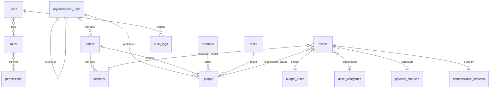

# Sistema institucional de activos fijos

## Inspección y alcance

Laravel instalado 12.70.1 (composer.lock), PHP requerido ^8.2, CLI 8.2.12. Blade con Vite 7 y Tailwind 4 declarados; sin SPA, API ni autenticación previa. MySQL configurado en .env, SQLite en .env.example y pruebas. Paquetes de aplicación: framework y Tinker; no se añadieron dependencias. Se conservaron migraciones originales de usuarios, sesiones, caché y colas. No había tabla de migraciones al comenzar.

Esta entrega implementa exclusivamente fase 1. Los Excel de E:/DON JAVIER/formularios se localizaron, pero sus hojas y datos no fueron analizados ni importados. El diseño se basa en los requisitos del texto adjunto; validar plantillas concretas antes de fases de reportes/importación. No se implementan reglas legales.

## Modelo global y cardinalidades

Las categorías también admiten jerarquía. Activos tienen unidad y oficina actuales con validación de coherencia. Foreign keys restringen eliminaciones, códigos son únicos y las relaciones están indexadas. Los catálogos y maestros se desactivan; no se expone DELETE. Código institucional personal opcional único: revisar esta decisión antes de migrar datos históricos. Importes usan decimal(18,2), nunca float en almacenamiento.

### Entidades previstas, todavía sin migraciones

- `asset_movements` 1:N `asset_movement_items`, cada detalle N:1 activo: tipo, fecha, autor, origen y destino normalizados, estado y versión esperada. Formalización transaccional con lockForUpdate, orden estable de bloqueo y validación de situación actual.
- `asset_assignments`: intervalos de responsabilidad cerrados por movimientos. Un único responsable actual en assets; cada documento conserva nombres, cargo, grado, unidad y oficina en columnas de snapshot. No se generan asignaciones desde la edición base.
- `acquisitions` / `acquisition_items` y `donations` / `donation_items`: cabeceras 1:N detalles, activos y documentos de respaldo. No almacenar totales manuales que diverjan del detalle.
- `missing_asset_cases` N:1 activo original; `replacement_records` N:1 caso y N:1 activo recuperado/reemplazo; el original permanece.
- `deposit_movements` complementa un movimiento, con origen y depósito destino; `revaluation_cases` conserva valores anteriores y resultados autorizados separados.
- `vehicle_details` 1:1 assets; `vehicle_types` configurable. Placa/chasis/motor indexados; evaluar duplicados reales antes de imponer unicidad.
- `documents`, `document_sequences`: correlativo bloqueado por tipo/gestión/unidad, único por ámbito; documento definitivo con versión y snapshot inmutable. Anulación/reversión mediante nueva operación con motivo, autor, fecha y referencia original.
- `attachments`: metadatos y asociaciones explícitas a procesos/documentos; archivos privados y descarga autorizada.
- `import_batches` 1:N `import_rows`: fila original conservada, advertencias y resultado; previsualización y confirmación antes de afectar inventario.

AF-001/002/003 consultarán el inventario y asignaciones; AF-004/005/006 se emitirán desde movimientos; los demás desde procesos vinculados. No existen tablas por formulario. Los cuadros de vehículos se calcularán desde activos y su ficha.

## Seguridad y auditoría

Acceso por sesión con regeneración de identificador y protección CSRF. Registro público ausente. Login limitado por correo/IP y endpoint. Usuarios inactivos no acceden ni conservan sesión válida. Gates consultan roles/permisos en servidor para lectura y escritura; editar las URL no evita autorizaciones. Roles iniciales persistidos con permisos configurables; superadministrador conserva permisos de recuperación. Usuarios administradores pueden asignar todos los roles: es una atribución privilegiada deliberada.

Alcance actual de acceso institucional: global por permiso. Antes de desplegar con aislamiento entre unidades, definir e implementar el alcance por unidad en consultas y acciones; no se presupone ese aislamiento.

Escrituras administrativas y auditoría están en una transacción. Auditoría registra antes/después, actor, motivo, IP y user agent. Nunca contraseñas ni tokens. Modelo de auditoría rechaza actualización/eliminación; el administrador de base de datos puede alterar datos mediante SQL: para garantías frente a ese actor se requiere cuenta restringida, retención y respaldo externo. Login/logout también se registran.

Ediciones comparan token SHA-256 del registro leído contra el registro bloqueado; activos además usan versión incremental. La prueba SQLite verifica conflictos lógicos y rollback, no demuestra concurrencia real de InnoDB. Cambios simultáneos de jerarquía o catálogos requieren una política de bloqueo más amplia antes del uso concurrente institucional. No se permiten ubicaciones de depósito en alta base: ese ingreso necesita un movimiento posterior.

## Operación

Alternativa para el usuario inicial: configurar `INITIAL_ADMIN_NAME`, `INITIAL_ADMIN_EMAIL` y `INITIAL_ADMIN_PASSWORD` (mínimo 12 caracteres) en `.env`, ejecutar `php artisan config:clear` y luego `php artisan db:seed`. DatabaseSeeder ejecuta FoundationSeeder antes de InitialAdminSeeder. No se modifica ni se eleva un usuario cuyo correo ya exista. Sin correo configurado se omite este seeder. Retirar la contraseña inicial de `.env` después de crear la cuenta y limpiar nuevamente la configuración.

1. Configurar .env con base de datos y APP_KEY. Mantener MySQL actual; .env.example conserva SQLite de desarrollo.
2. `php artisan migrate --seed` (no usar migrate:fresh con datos).
3. `php artisan app:create-admin correo@institucion.tld "Nombre completo"`; solicita contraseña de al menos 12 caracteres sin mostrarla. No existen credenciales por defecto.
4. Servir con raíz en `public`, por ejemplo `php artisan serve`; ingresar a `/login`.
5. Crear unidades, oficinas, ubicaciones, cargos, grados y responsables. Configurar partidas/categorías y dar altas base de activos. Asignación responsable, bajas, depósitos y movimientos quedan para fases posteriores.
6. `php artisan test`; `php vendor/laravel/pint/builds/pint --test`.

Vistas de fase 1 usan CSS local sencillo y no requieren npm ni CDN. Dependencias Vite/Tailwind se mantienen para evolución de interfaz. Configurar HTTPS, APP_DEBUG=false, cookies seguras, zona horaria institucional, respaldos y cuenta SQL con privilegios mínimos antes de producción. No se modificó .env ni se eligió una institución por defecto.

## Límites de fase 1

Inventario base permite crear/editar datos descriptivos y ubicación disponible; no implementa filtros avanzados, historial de movimientos, asignaciones, reportes AF, vehículos, PDFs, adjuntos, importación ni revalúo. Auditoría básica registra cambios de ficha pero no reemplaza el modelo de movimientos de fase 2/3. Los snapshots definitivos pertenecen a esas fases. No se declara esta base lista para producción institucional sin completar y validar los procesos requeridos.
